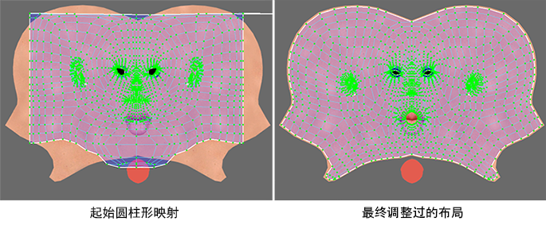

# 映射 UV

映射 UV 是指为网格指定 UV 的实际过程。通常情况下，可以通过将 UV 从一个或多个基本体对象（例如，平面、圆柱体或球体）投影到近似于网格轮廓的网格曲面开始该过程。例如：

- 将平面映射投影到平坦的街道或建筑面上。

- 将圆柱形贴图投影到头部或躯干周围。

- 将轮廓拉伸贴图投影到凹凸不平的丘陵地形上。

创建初始贴图之后，您将使用“UV 编辑器”(UV Editor)中的工具调整 UV，以更好地适配实际网格。

 <!-- baize:img-hook downloaded=true reason="正文 188 字 <300 且带图" -->
