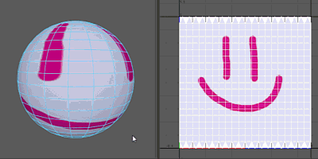

# 最佳平面 UV 映射

最佳平面 UV 映射通过投影连接指定组件的最佳平面，基于指定的面/顶点为多边形网格创建 UV。它对于投影到选定面的子集特别有用。

 <!-- baize:img-hook downloaded=true reason="正文 205 字 <300 且带图" -->

使用最佳平面映射来映射 UV

1. 选择要创建 UV 的对象上的面（或整个对象本身）。

2. 选择“UV > 最佳平面”(UV > Best Plane)。

  Maya 会自动切换为组件模式。

3. 按住 Shift 键并至少选择一个面或 3 个顶点/CV/定位器，以定义投影平面。

4. 按 Enter 键。

Maya 将映射 UV 以适配包含选定组件的平面。
