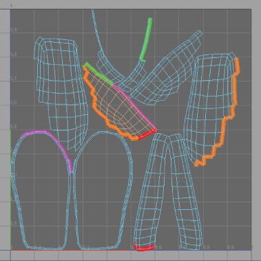

# 显示 UV 壳上连接的边

要对具有许多 UV 壳的模型执行 UV 映射操作时，了解哪些壳边已连接很有帮助。

**注**

连接的边仅显示在

UV 编辑器

中。

显示 UV 壳上连接的边

1. 按 8 键。

各组连接的边将以不同的颜色显示，以便于识别共有的边。

**注**

提示：

您可以通过选择

“显示 > 多边形 > 边宽度”(Display > Polygons > Edge Width)

调整壳边界的宽度。

或者，您可以按 Shift 键并在 2D 视图中单击鼠标右键，然后选择“切换壳边界”(Toggle Shell Borders)。

 <!-- baize:img-hook downloaded=true reason="正文 230 字 <300 且带图" -->

## 相关主题

- [UV 编辑器概述](../“UV%20编辑器”%28UV%20Editor%29概述.md)

- [分离和附加 UV 壳](../编辑%20UV/分离和附加%20UV.md)
