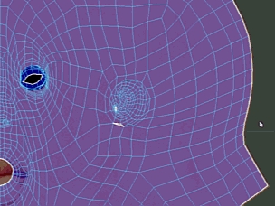
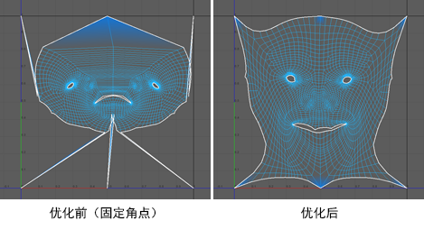

# 固定 UV

 <!-- baize:img-hook downloaded=true reason="正文 273 字 <300 且带图" -->

您可以固定 UV，防止它们在各种操作期间移动，例如，抓取、涂抹、展开等。如果您对某些 UV 的位置感到满意，但是仍想修改周围的 UV，这将非常有用。这在展开或优化时也很有用，因此通过该操作可以冻结壳边界周围 UV 的位置，然后相对于这些 UV 展开/优化。

 <!-- baize:img-hook downloaded=true reason="正文 273 字 <300 且带图" -->

固定 UV

1. 切换到 UV 选择模式。

2. 选择要固定的 UV。

3. 在“UV 工具包”(UV Toolkit)中，转到“固定 > 固定”(Pinning > Pin)。

  已固定 UV 周围的区域将变为蓝色，以指示其处于固定状态。现在，除非直接选择这些 UV 并使用变换工具，否则您无法在各种操作期间移动它们。

## 相关主题

- [固定 UV 工具(Pin UV Tool)](../UV%20参考/UV%20工具/固定%20UV%20工具%28Pin%20UV%20Tool%29.md)
