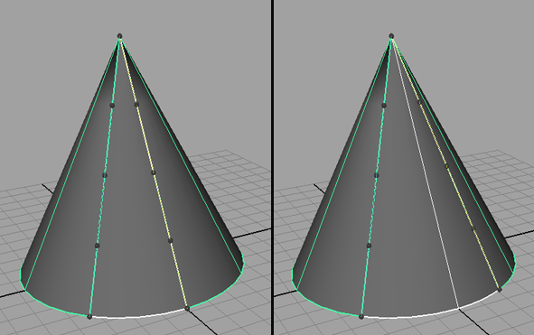

# 分离曲面选项(Detach Surfaces Options)

将一个曲面按照选定等参线分割为多个曲面。

#### 保持原始(Keep Original)

如果在执行分离时启用“保持原始”(Keep Original)，则仍将保留原始曲线或曲面。

## 更改分离位置

可以使用“显示操纵器工具”(Show Manipulator Tool)编辑分离的区域。在“通道盒”(Channel Box)中选择分离的曲线和 detachSurface 节点，然后选择“显示操纵器工具”(Show Manipulator Tool)。如果拖动黑色操纵器，将相应地扩大和缩小分离区域。

 <!-- baize:img-hook downloaded=true reason="正文 247 字 <300 且带图" -->

## 相关主题

- [分割曲线或曲面（分离）](https://help.autodesk.com/cloudhelp/2022/CHS/Maya-Modeling/files/GUID-D42B5077-4D64-4942-875D-F39F69506087.htm)
