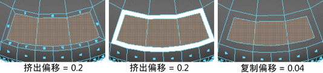

# 复制面选项(Duplicate Faces Options)

使用这些选项可设置在选择“编辑网格 > 复制”(Edit Mesh > Duplicate)时发生的情况。

#### 分离复制的面

复制后自动分隔面。复制面分离到自己的单独对象中。不会影响网格中的任何已存在的壳。

#### 偏移

输入值以偏移复制的面的边。此处还显示用于提取和挤出面的偏移以供比较。该选项可用于对使用“提取”(Extract)生成的挤出、裁切对象围绕面制作倒角效果，以及均匀缩放复制的面。

 <!-- baize:img-hook downloaded=true reason="正文 193 字 <300 且带图" -->

## 相关主题

- [复制多边形面](../../../编辑多边形/修改多边形网格/复制多边形面.md)
