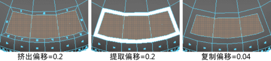

# 提取选项(Extract Options)

使用这些选项可设置在选择“编辑网格 > 提取”(Edit Mesh > Extract)时发生的情况。

#### 分离提取的面

启用（默认）时，在提取面后自动分离它们。提取的面将分离到单独的对象中。不会影响网格中的任何已存在的壳。禁用时，在提取面之后自动选择它们并激活组件模式。

#### 偏移

输入值以偏移提取的面的边。此处还显示用于挤出和复制面的偏移以供比较。该选项可用于对使用“提取”(Extract)生成的挤出、裁切对象围绕面制作倒角效果，以及均匀缩放复制的面。

 <!-- baize:img-hook downloaded=true reason="正文 226 字 <300 且带图" -->

## 相关主题

- [从网格提取面](../../../编辑多边形/合并、分割和拆分/合并和分离多边形网格/从网格提取面.md)
