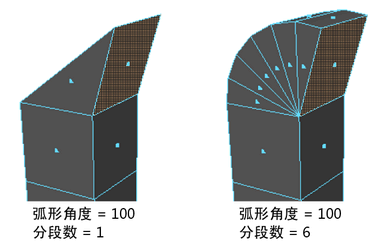

# 楔形选项(Wedge Options)

使用这些选项可设置在选择“编辑网格 > 楔形”(Edit Mesh > Wedge)时发生的情况。

#### 弧形角度

围绕枢轴边旋转的度数。

#### 分段

围绕旋转的细分数。

 <!-- baize:img-hook downloaded=true reason="正文 88 字 <300 且带图" -->

## 相关主题

- [在圆弧或楔形形状中挤出多边形](../../../编辑多边形/修改多边形网格/挤出多边形的面、边或顶点/在圆弧或楔形形状中挤出多边形.md)
