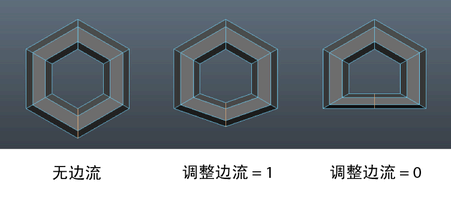

# 编辑边流选项(Edit Edge Flow Options)

使用此选项可设置选择“编辑网格 > 编辑边流”(Edit Mesh > Edit Edge Flow)时发生的情况。

#### 调整边流(Adjust Edge Flow)

输入值或调整滑块以更改选定边的形状。

将“调整边流”(Adjust Edge Flow)设置为 1 可变换选定边的曲面曲率以遵循周围网格的曲率。设置为 0 时，选定的边将移动到附近其他边的中间，从而形成平面。

 <!-- baize:img-hook downloaded=true reason="正文 176 字 <300 且带图" -->

## 相关主题

- [编辑边流](../../../编辑多边形/修改多边形网格/编辑边流.md)
