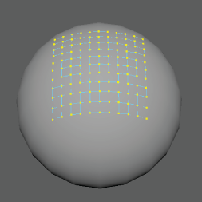
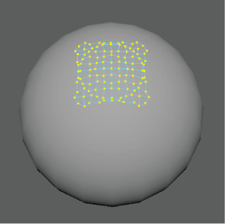

# 一致选项(Conform Options)

使用[一致(Conform)](../../../编辑多边形/变换多边形组件/使顶点与曲面保持一致.md)命令可以将一个对象的顶点包裹到另一个对象上。使用以下选项可设置选择“网格 > 一致”(Mesh > Conform)时发生的情况。

#### 投影(Projection)

#### 沿法线(Along Normals)

将每个选定组件捕捉到激活曲面上的最近点。在以下示例中，沿平面法线将平面的顶点捕捉到球体。

 <!-- baize:img-hook downloaded=true reason="正文 222 字 <300 且带图" -->

#### 最近点(Closest Point)

将每个组件捕捉到激活曲面上的最近点。在以下示例中，将平面的顶点捕捉到球体上的最近点。

 <!-- baize:img-hook downloaded=true reason="正文 222 字 <300 且带图" -->

## 相关主题

- [使顶点与曲面保持一致](../../../编辑多边形/变换多边形组件/使顶点与曲面保持一致.md)
