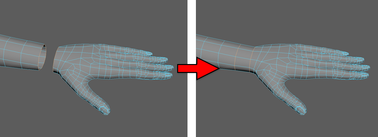

# “桥接”(Bridge)命令

可以使用“桥接”(Bridge)命令在各对边界边之间构建面。生成的桥接面将合并到原始网格中。如果需要通过一块网格将两组边连接到一起，“桥接”(Bridge)十分有用。例如，将某个角色手臂上的手腕连接并合并到手上。

 <!-- baize:img-hook downloaded=true reason="正文 283 字 <300 且带图" -->

使用以下方法之一访问“桥接”(Bridge)命令：

- 从主菜单栏中选择“编辑网格 > 桥接”(Edit Mesh > Bridge)。

- 从标记菜单（Shift + 单击鼠标右键）中选择“桥接”(Bridge)

- 在[建模工具包](../多边形建模工具/建模工具包%28Modeling%20Toolkit%29.md)中单击  <!-- baize:img-hook downloaded=true reason="正文 283 字 <300 且带图" -->

有关如何使用“桥接”(Bridge)命令的详细信息，请参见相关主题。

## 相关主题

- [边界边之间的桥接](../../编辑多边形/合并、分割和拆分/合并多边形/边界边之间的桥接.md)

- [桥接网格疑难解答](../../编辑多边形/合并、分割和拆分/合并多边形/桥接网格疑难解答.md)

- [组合选项(Combine Options)](../“建模”%28Modeling%29菜单集/“网格”%28Mesh%29菜单/组合选项%28Combine%20Options%29.md)
