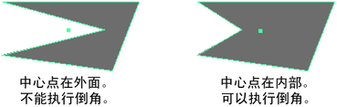

# 倒角疑难解答

## 凸面和凹面

“倒角”(Bevel)工具作用于凸面，甚至星形凹面。但对于中心点不在面内的凹面，倒角会生成不合需要的结果。

 <!-- baize:img-hook downloaded=true reason="正文 144 字 <300 且带图" -->

若要修复凹面，请使用[“多切割工具”(Multi-Cut Tool)](../../多边形建模工具/多切割工具.md)或“网格 > 三角化”(Mesh > Triangulate)。

## 相关主题

- [倒角命令](../倒角命令.md)

- [倒角选项(Bevel Options)](../../“建模”%28Modeling%29菜单集/“编辑网格”%28Edit%20Mesh%29菜单/倒角选项%28Bevel%20Options%29.md)
