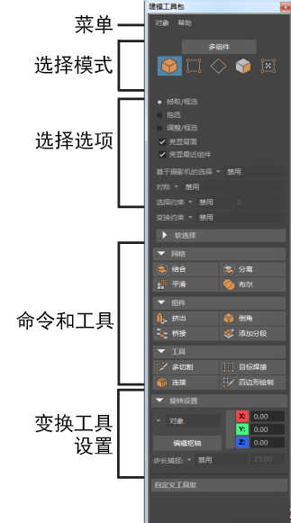

# 建模工具包(Modeling Toolkit)

若要打开“建模工具包”(Modeling Toolkit)，请单击[状态行](https://beehive.autodesk.com/community/service/rest/cloudhelp/resource/cloudhelpchannel/guidcrossbook/jsonp?v=2022&p=MAYAUL&l=CHS&accessmode=live&guid=GUID-86E5CEDA-4100-40AE-8F95-346206CF8456)中的  <!-- baize:img-hook downloaded=true reason="正文 56 字 <300 且带图" -->。

可用来从一个窗口启动多个建模工作流。

 <!-- baize:img-hook downloaded=true reason="正文 56 字 <300 且带图" -->
