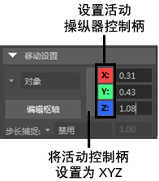

# 建模工具包变换工具设置

仅当 Maya 的变换工具之一处于活动状态时，“建模工具包”(Modeling Toolkit)窗口中才显示变换工具设置。

 <!-- baize:img-hook downloaded=true reason="正文 90 字 <300 且带图" -->

有关变换工具设置的详细信息，请参见[移动工具](https://beehive.autodesk.com/community/service/rest/cloudhelp/resource/cloudhelpchannel/guidcrossbook/jsonp?v=2022&p=MAYAUL&l=CHS&accessmode=live&guid=GUID-9BCE8B23-6DA6-4C7F-B897-7E25D6E8A865)、[旋转工具](https://beehive.autodesk.com/community/service/rest/cloudhelp/resource/cloudhelpchannel/guidcrossbook/jsonp?v=2022&p=MAYAUL&l=CHS&accessmode=live&guid=GUID-C2D0F80C-812B-465D-A634-DB6ECFABFCB3)和[缩放工具](https://beehive.autodesk.com/community/service/rest/cloudhelp/resource/cloudhelpchannel/guidcrossbook/jsonp?v=2022&p=MAYAUL&l=CHS&accessmode=live&guid=GUID-487B6A23-E135-45E2-94F1-B0D59D6B6F33)。
