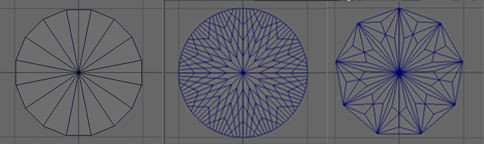

# polyDisc

 <!-- baize:img-hook downloaded=true reason="正文 231 字 <300 且带图" -->

每次创建圆盘基本体时，便创建 polyDisc 节点。

#### 边(Sides)

确定封口的平滑度。

#### 细分模式(Subdivision mode)

确定将圆盘的每个切片进一步细分的形状。选项包括“四边形”(Quads)、“三角形”(Triangles)、“饼图”(Pie)、“封口”(Caps)和“圆形”(Circle)。

#### 细分数(Subdivisions)

确定使用“细分模式”(Subdivision mode)细分基础面的次数。

#### 半径(Radius)

根据从中心到一侧的边长确定圆盘大小。
