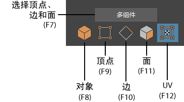

# 使用建模工具包选择模式选择组件

使用建模工具包选择模式选择组件

1. 在[“建模工具包”(Modeling Toolkit)窗口](../../多边形建模参考/多边形建模工具/建模工具包%28Modeling%20Toolkit%29.md)中单击其中一个选择模式图标，或按热键来激活一个选择模式。

   <!-- baize:img-hook downloaded=true reason="正文 198 字 <300 且带图" -->

2. 选择网格上的组件。

  将某个组件添加到选择时 (Ctrl + Shift)，将以红色亮显该组件。从选择中去除某个组件时 (Ctrl)，将以黄色亮显该组件。您可以在“建模工具包”(Modeling Toolkit)首选项中调整亮显颜色。

## 相关主题

- [建模工具包选择模式](../../多边形建模参考/多边形建模工具/建模工具包%28Modeling%20Toolkit%29/建模工具包选择模式.md)

- [建模工具包](../../多边形建模参考/多边形建模工具/建模工具包%28Modeling%20Toolkit%29.md)
