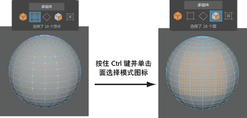

# 将组件选择转化为其他组件类型

将组件选择转化为其他组件类型

1. 选择一组组件。

2. 在建模工具包中，按住 Ctrl 键并单击选择模式图标。

  系统会将当前选择转化为其他组件类型。

  在下面的示例中，系统将顶点转化为面。

   <!-- baize:img-hook downloaded=true reason="正文 105 字 <300 且带图" -->

## 相关主题

- [建模工具包](../../多边形建模参考/多边形建模工具/建模工具包%28Modeling%20Toolkit%29.md)

- [使用建模工具包选择多边形组件](../使用建模工具包选择多边形组件.md)
