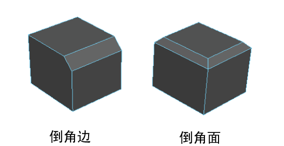

# 倒角多边形边和面

倒角会将选定的每条边展开为一个新面，为多边形网格的边添加圆角。请参见[倒角命令](../../多边形建模参考/多边形建模命令/倒角命令.md)。

对边或面进行倒角

1. 选择网格对象，或者选择要进行倒角的边或面。

  **注**

  如果选择网格对象，Maya 会倒角网格中的每条边。

2. 从主菜单中选择“编辑网格 > 倒角”(Edit Mesh > Bevel)，或者在建模工具包中单击  <!-- baize:img-hook downloaded=true reason="正文 239 字 <300 且带图" -->。

  Maya 将对选定边或选定面的周长边进行倒角。

  **注**

  执行倒角操作后，将会保留逐面着色器指定。

   <!-- baize:img-hook downloaded=true reason="正文 239 字 <300 且带图" -->

3. 在显示的[视图中编辑器](../../多边形建模参考/多边形建模编辑器/视图中编辑器.md)中，调整 [polyBevel](../../多边形建模参考/多边形节点/polyBevel.md) 属性。

## 相关主题

- [倒角命令](../../多边形建模参考/多边形建模命令/倒角命令.md)

- [倒角选项(Bevel Options)](../../多边形建模参考/“建模”%28Modeling%29菜单集/“编辑网格”%28Edit%20Mesh%29菜单/倒角选项%28Bevel%20Options%29.md)

- [切角顶点](切角顶点.md)
