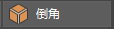

# 切角顶点

使用建模工具包中的“网格 > 切角顶点”(Mesh > Chamfer Vertices)或“倒角”(Bevel)，可以在顶点位置创建切角的角点。“切角”(Chamfer)会移除顶点并创建切角处理后得到的角。

切角顶点

1. 选择要进行切角处理的顶点。

2. 在主菜单中选择“编辑网格 > 切角顶点”(Edit Mesh > Chamfer Vertices)或者在建模工具包中单击  <!-- baize:img-hook downloaded=true reason="正文 214 字 <300 且带图" -->。

3. 在显示的[视图中编辑器](../../多边形建模参考/多边形建模编辑器/视图中编辑器.md)中，调整 polyChamfer 属性。

## 相关主题

- [倒角多边形边](倒角多边形边和面.md)

- [倒角命令](../../多边形建模参考/多边形建模命令/倒角命令.md)
