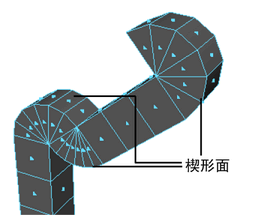
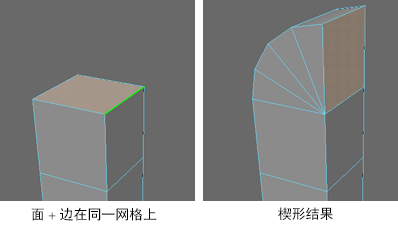
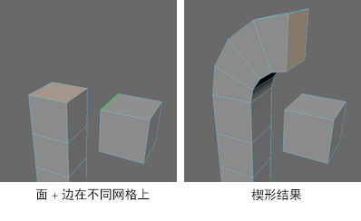
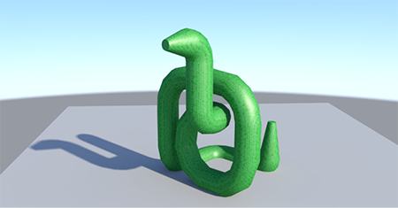

# 在圆弧或楔形形状中挤出多边形

可以使用“楔形”(Wedge)功能挤出面以快速创建：

- 建筑物中的拱

- 角色中的膝盖和肘部

- 道路或隧道的弯曲部分

   <!-- baize:img-hook downloaded=true reason="正文 225 字 <300 且带图" -->

在圆弧或楔形形状中挤出多边形

1. 切换到[多组件选择模式](https://beehive.autodesk.com/community/service/rest/cloudhelp/resource/cloudhelpchannel/guidcrossbook/jsonp?v=2022&p=MAYAUL&l=CHS&accessmode=live&guid=GUID-9853C085-85BD-44C2-8FA6-04E3DC31A1F3)。

2. 选择要挤出的面，然后选择边。此边既可以位于同一网格上，也可以位于完全不同的网格上。如果选择多条边，则挤出将绕其平均方向旋转。

   <!-- baize:img-hook downloaded=true reason="正文 225 字 <300 且带图" -->

   <!-- baize:img-hook downloaded=true reason="正文 225 字 <300 且带图" -->

3. 选择编辑网格 > 楔形(Edit Mesh > Wedge)。

4. 在显示的[视图中编辑器](../../../多边形建模参考/多边形建模编辑器/视图中编辑器.md)中，调整 polyWedgeFace 节点属性。

 <!-- baize:img-hook downloaded=true reason="正文 225 字 <300 且带图" -->

## 相关主题

- [平滑多边形网格](../../平滑多边形/通过添加新的多边形平滑网格.md)

- [楔形选项(Wedge Options)](../../../多边形建模参考/“建模”%28Modeling%29菜单集/“编辑网格”%28Edit%20Mesh%29菜单/楔形选项%28Wedge%20Options%29.md)
