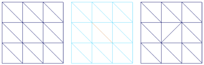

# 翻转三角形边

可以变换拆分两个三角形多边形的边，以便它连接对角。在多边形数量较少的模型的形状中，这通常会造成显著的差异，或改善多边形网格的可视流。

 <!-- baize:img-hook downloaded=true reason="正文 254 字 <300 且带图" -->

例如，多边形面上的边的放置或方向可以确定角色模型上鼻梁的剖面和放置或脸颊的放置。

翻转边

1. 选择一条或多条要翻转的边。

  该边应该是两个三角形之间的共享边。

2. 选择编辑网格 > 翻转三角形边(Edit Mesh > Flip Triangle Edge)。

## 翻转三角形边疑难解答

**我无法翻转边，该怎么办？**

- 无法翻转充当 UV 空间中的纹理边界的边。

- 无法翻转边界边，包括洞边界。

- 无法翻转长度为零的边。

### 相关主题

- [编辑网格](../../多边形建模参考/“建模”%28Modeling%29菜单集/“编辑网格”%28Edit%20Mesh%29菜单.md)
