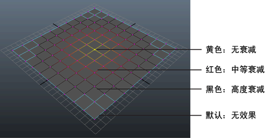

# 修改软选择衰减

衰减是软选择组件周围的区域，其中工具效果逐渐减弱。随着衰减的增加，变换效果将减小。衰减以颜色渐变表示。

 <!-- baize:img-hook downloaded=true reason="正文 87 字 <300 且带图" -->

**注**

颜色渐变将显示在边上，不受当前组件选择模式的影响。

## 相关主题

- [软修改工具](https://beehive.autodesk.com/community/service/rest/cloudhelp/resource/cloudhelpchannel/guidcrossbook/jsonp?v=2022&p=MAYAUL&l=CHS&accessmode=live&guid=GUID-C7F51FE8-B238-4BFB-B034-69F2388D91F1)
