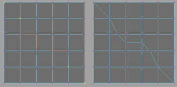

# 连接任意组件

可以使用“连接组件”(Connect Components)工具通过一次操作将多个顶点和边与边连接。这些组件必须相邻，这意味着每个顶点或边必须作为最后一个与相邻面接界。

连接任意组件

1. 按住 Shift 键选择作为相邻面边界的顶点和边。

2. 选择“编辑网格 > 连接”(Edit Mesh > Connect)。

  此时选定组件已由多个边相连接。顶点将直接连接到连接边，而边将在其中点处进行连接。

 <!-- baize:img-hook downloaded=true reason="正文 218 字 <300 且带图" -->

## 相关主题

- [连接组件选项(Connect Components Options)](../../../多边形建模参考/“建模”%28Modeling%29菜单集/“编辑网格”%28Edit%20Mesh%29菜单/连接组件选项%28Connect%20Components%20Options%29.md)
