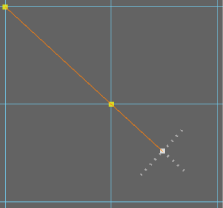
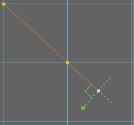
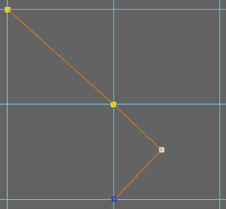
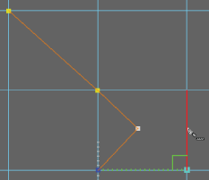

# 使用多切割工具进行 90 度角切割

使用多切割工具进行 90 度角切割

1. 开始进行切割。请参见[使用多切割工具切割面](使用多切割工具切割面.md)。

2. 想要进行 90 度角切割时，请同时按住 Ctrl 和 Shift 键并将光标向上一个切割点移近。

  灰色量角器线显示为与上一个分段呈 90 度和 180 度角。

   <!-- baize:img-hook downloaded=true reason="正文 262 字 <300 且带图" -->

3. 在其中一条量角器线上方移动光标。

  在沿量角器线方向移动光标时，将会显示一条绿色切割预览线。

   <!-- baize:img-hook downloaded=true reason="正文 262 字 <300 且带图" -->

4. 单击网格放置切割点并创建 90 度角切割。

   <!-- baize:img-hook downloaded=true reason="正文 262 字 <300 且带图" -->

在现有边上查找 90 度角

1. 同时按住 Ctrl 和 Shift 键并在现有边上方移动光标以查找其他 90 度角。

   <!-- baize:img-hook downloaded=true reason="正文 262 字 <300 且带图" -->

## 相关主题

- [多切割工具](../../../../多边形建模参考/多边形建模工具/多切割工具.md)

- [使用多切割工具将切割点捕捉到边](使用多切割工具将切割点捕捉到边.md)

- [使用多切割工具重新定位切割点](使用多切割工具重新定位切割点.md)

- [使用多切割工具切割面](使用多切割工具切割面.md)
