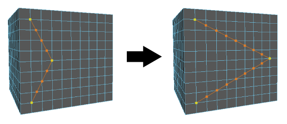

# 使用多切割工具重新定位切割点

重新定位切割点

1. 开始进行切割。请参见[使用多切割工具将图案切割为几何体面](使用多切割工具切割面.md)。

  **注**

  提示：

  启用对象、世界或拓扑对称，以便在网格的两侧进行切割。请参见

  激活或取消激活对称

  。

2. 将光标移到某个切割点上。

  该切割点将以红色亮显。

3. 将该切割点拖动到另一个面、边或顶点。

  若要重新定位第一个切割点，请使用鼠标中键将其拖动到另一位置。

  **注**

  不能在切割线上拖动切割点。

  当您拖动切割点时，会沿着切割线自动插入附加的橙色点。

   <!-- baize:img-hook downloaded=true reason="正文 290 字 <300 且带图" -->

重新定位最后一个切割点

1. 使用鼠标中键拖动到网格上的任意位置以调整最后一个切割点。

  **注**

  光标不需要直接悬停在最后一个切割点上以进行重新定位。

## 相关主题

- [多切割工具](../../../../多边形建模参考/多边形建模工具/多切割工具.md)

- [使用多切割工具将切割点捕捉到边](使用多切割工具将切割点捕捉到边.md)

- [使用多切割工具切割面](使用多切割工具切割面.md)
