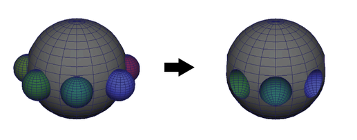
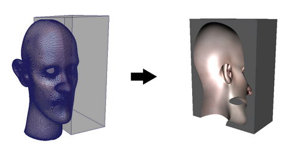
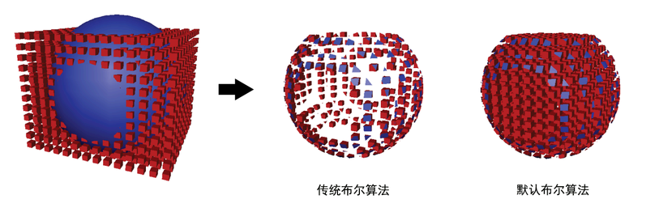

# 关于布尔

下列功能使 Maya 的布尔成为可靠的建模技术。

## 多个对象

可以在一个“差集”(Difference)布尔运算中使用多个对象。在以下示例中，将从一个大型球体中减去一圈小型球体，从而创建一系列裁切。

 <!-- baize:img-hook downloaded=true reason="正文 261 字 <300 且带图" -->

## 大型数据集

布尔使内存使用量保持在最低级别，以便您可以对较大的复杂场景和稠密的网格执行布尔运算，而不会影响 Maya 的性能。

 <!-- baize:img-hook downloaded=true reason="正文 261 字 <300 且带图" -->

## 可预测的结果

在实例中，布尔可以产生正确且可预测的布尔结果，而 Maya 旧版布尔算法会产生不希望的结果。在以下示例中，将使用两种算法合并一个球体和一组立方体。

 <!-- baize:img-hook downloaded=true reason="正文 261 字 <300 且带图" -->

## 相关主题

- [布尔](../布尔.md)

- [使用布尔运算组合多边形网格](使用布尔运算组合多边形网格.md)

- [布尔的最佳实践](布尔的最佳实践.md)

- [布尔限制](布尔限制.md)
