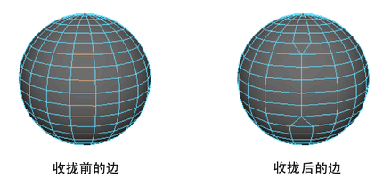

# 合并选择的边

您可以使用“编辑网格 > 收拢”(Edit Mesh > Collapse)逐个组件收拢边。

**注**

提示：

此命令还适用于面，但会产生不可预料的结果。如果要收拢并合并所选的面，请尝试使用

“编辑网格 > 合并到中心”(Edit Mesh > Merge to Center)

。

合并选择的边

1. 选择要在逐个组件的基础上合并的边。

2. 选择编辑网格> 收拢(Edit Mesh > Collapse)。

  每条边均会收拢，其顶点则将合并。

   <!-- baize:img-hook downloaded=true reason="正文 188 字 <300 且带图" -->
