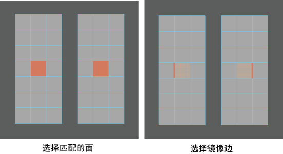

# 使用拓扑对称编辑多个壳

如果两个壳具有相同的拓扑，并且是同一组合几何体的一部分（如头部网格中的眼球），则可以使用拓扑对称同时编辑它们。

使用拓扑对称编辑多个壳

1. 选择要编辑的壳。

  **注**

  提示：

  多个壳是组合网格的一部分时，只能在其上使用拓扑对称。选择

  “网格 > 结合”(Mesh > Combine)

  将两个单独的壳组合到单个网格中。

2. 选择每个壳上的面。

  这些面必须匹配。

3. 选择与每个选定面相邻的边。

  这两条边必须是镜像的。

   <!-- baize:img-hook downloaded=true reason="正文 261 字 <300 且带图" -->

4. 激活拓扑对称。请参见[激活或取消激活对称](激活或取消激活对称.md)。

5. 在一个壳上移动光标，组件将在这两个壳上亮显。

6. 使用变换工具编辑壳。

## 相关主题

- [使用部分拓扑对称编辑网格](使用部分拓扑对称编辑网格.md)

- [使用拓扑对称编辑网格](使用拓扑对称编辑网格.md)
