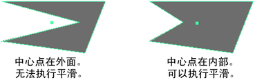

# 平滑功能疑难解答

## 平滑作用异常或根本无效

平滑在凸面和甚至星形凹面上也适用。但是，对于中心点不在面内的凹面，平滑可能会产生不必要的结果。

 <!-- baize:img-hook downloaded=true reason="正文 134 字 <300 且带图" -->

若要修复凹面，请使用[多切割工具(Multi-Cut Tool)](../../../多边形建模参考/多边形建模工具/多切割工具.md)或网格 > 三角化(Mesh > Triangulate)。

## 相关主题

- [通过添加多边形进行平滑](../通过添加新的多边形平滑网格.md)

- [平滑多边形](../../平滑多边形.md)
