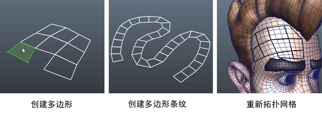

# 使用“四边形绘制”(Quad Draw)手动创建或重新拓扑网格

“四边形绘制”(Quad Draw)工具可用于创建约束到其他对象或平面的新网格。您可以使用“四边形绘制”(Quad Draw)工具执行以下操作：

 <!-- baize:img-hook downloaded=true reason="正文 143 字 <300 且带图" -->

除了创建新多边形外，“四边形绘制”(Quad Draw)工具还可用于优化现有多边形网格。这包括：

- [添加新的四边形](使用“四边形绘制”%28Quad%20Draw%29手动创建或重新拓扑网格/使用四边形绘制添加多边形.md)

- [添加新的循环边](使用“四边形绘制”%28Quad%20Draw%29手动创建或重新拓扑网格/使用四边形绘制插入循环边.md)

- [更改现有组件的布局](使用“四边形绘制”%28Quad%20Draw%29手动创建或重新拓扑网格/使用四边形绘制调整组件的位置.md)

- [填充洞](使用“四边形绘制”%28Quad%20Draw%29手动创建或重新拓扑网格/使用四边形绘制填充洞.md)
