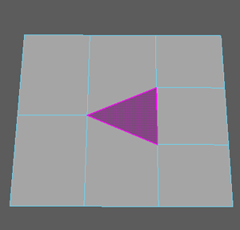
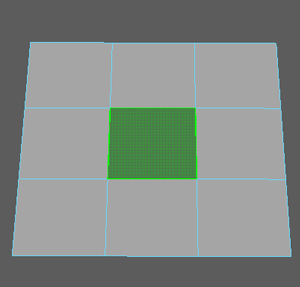

# 使用四边形绘制填充洞

您可以通过“四边形绘制”(Quad Draw)工具使用四边形或三角形（四边形通常更适用于变形）填充现有网格上的间隙。

使用“四边形绘制”(Quad Draw)填充洞

1. 选择网格。

2. 激活[四边形绘制(Quad Draw)](../../多边形建模参考/多边形建模工具/四边形绘制工具.md)工具。

3. 在按住 Shift 键的同时将光标移动到孔上。

  “四边形绘制”(Quad Draw)工具将进入预览模式。如果要创建的面是三角形，它将以紫色亮显：

   <!-- baize:img-hook downloaded=true reason="正文 240 字 <300 且带图" -->

  但如果要创建的面是四边形，它将以绿色亮显：

   <!-- baize:img-hook downloaded=true reason="正文 240 字 <300 且带图" -->

4. 按住 Shift 键单击面预览。

  此时将显示新面，并填充孔。

## 相关主题

- [利用四边形绘制优化拓扑](../自动重新拓扑网格.md)

- [建模工具包](../../多边形建模参考/多边形建模工具/建模工具包%28Modeling%20Toolkit%29.md)
