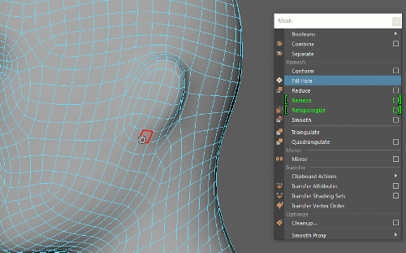

# 自动将多边形添加到网格中

可以使用“重新划分网格”(Remesh)命令将多边形拓扑添加到网格上的选定区域。如果要为区域添加更多细节，但没有足够的组件来处理，这将非常有用。

 <!-- baize:img-hook downloaded=true reason="正文 295 字 <300 且带图" -->

添加细节后，我们建议对整个网格运行“重新划分网格”(Remesh)，然后再运行 Retopo 以再次返回到均匀拓扑。

将细节添加到网格区域中

1. 选择网格上的组件以用作中心。

2. 在“建模”(Modeling)菜单集中，选择“网格 > 重新划分网格”(Mesh > Remesh)。

  这将根据[重新划分网格设置](../../多边形建模参考/“建模”%28Modeling%29菜单集/“网格”%28Mesh%29菜单/重新划分网格选项%28Remesh%20Options%29.md)将细节添加到区域中。

**注**

如果场景文件包含 Maya 2020 之前的

Retopo

节点，则应先删除网格上的历史，然后再执行其他

“重新划分网格”(Remesh)

/

Retopo

。
