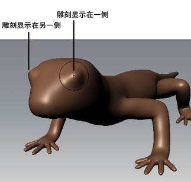

# 使用对称进行雕刻

使用[“对称”(Symmetry)](../../多边形建模/多边形建模/编辑多边形/对称编辑.md)设置可以将模型一侧的细节反射或镜像到另一侧。您可以使用“世界”(World)或“对象”(Object)对称来反射围绕轴居中放置的网格上的操作，或对其他位置居中放置的那些网格使用“拓扑”(Topological)对称。“拓扑”(Topological)对称甚至适用于部分对称的网格或姿势不对称的对称网格。

 <!-- baize:img-hook downloaded=true reason="正文 267 字 <300 且带图" -->

激活对称雕刻

1. 使用“状态行”(Status line)或相应雕刻工具的“工具设置”(Tool Settings)编辑器中的“对称”(Symmetry)下拉列表，设置对称模式。

## 相关主题

- [雕刻工具设置](雕刻工具设置.md)

- [雕刻工具热键](雕刻工具热键.md)
