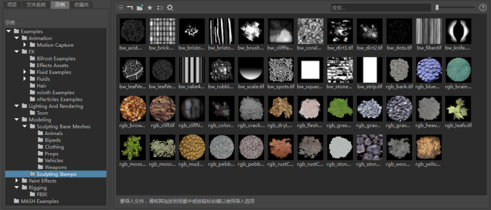
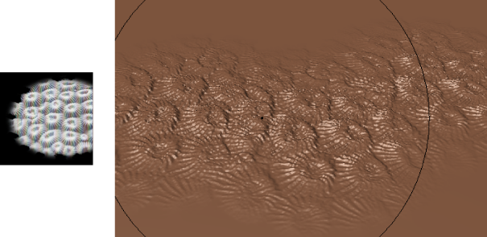

# 图章

图章与雕刻工具结合使用，用图像遮罩工具提示，使您可以将有趣的已雕刻细节和特征应用于模型。

 <!-- baize:img-hook downloaded=true reason="正文 272 字 <300 且带图" -->

图章图像中的黑色值充当完全保护模型的不透明区域。图像中的白色值充当允许工具特征影响模型的透明区域。图章图像之外的区域被视为黑色，并保持不受影响。

 <!-- baize:img-hook downloaded=true reason="正文 272 字 <300 且带图" -->

对于雕刻重复的特征（如刻度、鞋带、缝合、螺钉头）或很难以其他方式获得的随机带纹理效果，图章尤其有用。

在雕刻时可以通过以下两种方式应用图章：

- 重复的图章图像。请参见[使用重复的图章图像进行雕刻](图章/使用图章雕刻.md)。

- 图章图像的单个实例。请参见[使用“盖印”(Imprint)工具雕刻单个图章](图章/使用图章雕刻.md)。

**注**

必须将模型细分到适当的级别，图章细节才能可见。
