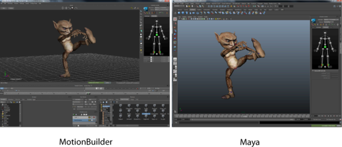

# 将控制装备发送到 MotionBuilder

可以使用**“发送到”(Send to)**命令在 Maya 和 MotionBuilder 之间传递 HumanIK 角色数据。这意味着不再需要将角色从 Maya 导出到 FBX 即可将角色导入 MotionBuilder。若要在 Maya “文件”(File)菜单中查看“发送到 MotionBuilder”(Send to MotionBuilder)命令，必须安装 MotionBuilder 的等效版本。

**注**

也可以使用

“发送到”(Send to)

命令，将标准对象和动画以及 HumanIK 角色发送到 MotionBuilder。

 <!-- baize:img-hook downloaded=true reason="正文 243 字 <300 且带图" -->
