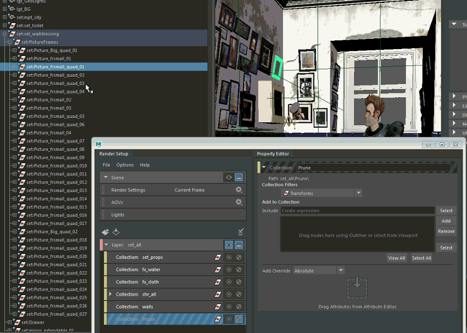

# 通过集合删减对象

集合自上而下进行解释。如果两个（或更多）集合共享对象且分别处于启用和禁用状态，则列表中排在最下面的集合将确定共享对象是否包含在层中。

此规则允许您从 DAG 层次中删减特定对象，使其不会显示在场景中。示例应用程序可能是一面悬挂了 20 帧的墙，而您要移除其中的 6 帧。这些帧是墙层次的子节点或孙节点，而该面墙位于层中的集合内。

从层中删减对象

1. 创建一个删减集合并将其添加为层中最底部的集合。

2. 禁用该删减集合，使其成员在将层设置为可见时不会显示。

3. 选择要删减的成员节点，然后在“特性编辑器”(Property Editor)中单击“添加”(Add)。

本示例中选定了 6 帧，在添加到该删减集合时这些帧将从层中消失。

 <!-- baize:img-hook downloaded=true reason="正文 293 字 <300 且带图" -->
