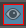

# 更新场景时更新渲染设置

场景发生更改时，层可见性图标  <!-- baize:img-hook downloaded=true reason="正文 164 字 <300 且带图" --> 周围可能显示红色边界，反映层成员身份可能已更改。单击该图标可相应地更新层。

如果使用某个表达式填充集合，然后将与此表达式匹配的节点添加到场景中（例如，通过创建或引用对象），则可能需要更新活动层以反映新添加的成员。此外，在创建覆盖或导入 .json 模板时，可能还需要刷新活动层。在红色边界出现时单击此图标。
