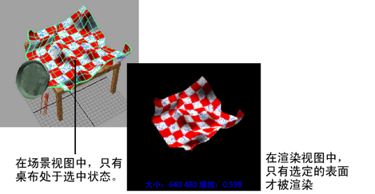

# 渲染选定的对象

**注**

提示：

以 1:1 分辨率渲染可获得最快的反馈。

您可以隔离要渲染的特定对象。请注意，使用 IPR 渲染时，必须先执行另一种 IPR 渲染，然后才能看到该更改的效果。

渲染选定曲面

1. 选择要渲染的对象。

2. 在“渲染视图”(Render View)窗口中，选择“渲染 > 仅渲染选定对象”(Render>Render Selected Objects Only)。

  渲染场景。

   <!-- baize:img-hook downloaded=true reason="正文 262 字 <300 且带图" -->

  **注**

  提示：

  可以显示场景的线框快照，用于指导您选择要渲染的场景区域。

  在“渲染视图”(Render View)中，选择“渲染 > 快照”(Render > Snapshot)，然后选择要捕捉的摄影机（视图）。
