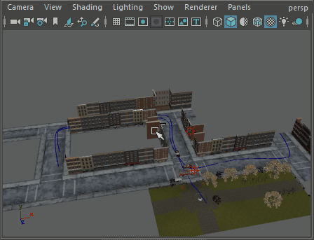
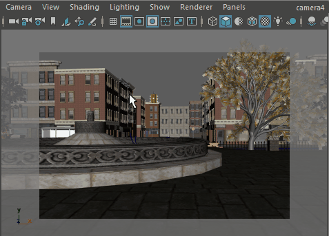

# 使用摄影机框显场景

为了生成有用的渲染，帧必须包含场景中的所有必要对象。为此，通常需要手动将摄影机指向这些对象，或者引导摄影机指向参考帧（例如，物体或定位器）。

查看和填充带场景区域的摄影机视图

1. 选择要框显的摄影机视图。请参见[切换摄影机视图](创建摄影机/切换摄影机视图.md)。

2. 按住 Ctrl+Alt 键的同时拖动该区域。

   <!-- baize:img-hook downloaded=true reason="正文 225 字 <300 且带图" -->

摄影机移动以使用选定区域填充摄影机的视图。另请参见[框显选定对象](使用摄影机框显场景/框显选定对象.md)。

3. 要将当前摄影机设为活动选定摄影机，请选择“摄影机 > 选择摄影机”(Camera > Select camera)。视图周围有白色细轮廓。

   <!-- baize:img-hook downloaded=true reason="正文 225 字 <300 且带图" -->
