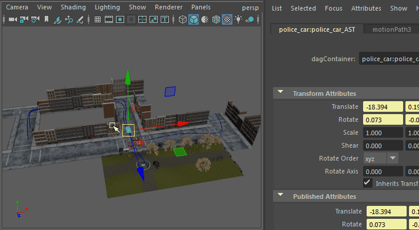

# 切换摄影机视图

有多种方法可以切换视口以在场景中显示摄影机的视点。

查看场景中的摄影机

1. 右键单击视口[视图面板](https://beehive.autodesk.com/community/service/rest/cloudhelp/resource/cloudhelpchannel/guidcrossbook/jsonp?v=2022&p=MAYAUL&l=CHS&accessmode=live&guid=GUID-455539A6-3506-458C-92DA-14F171C14553)图标中的摄影机图标  <!-- baize:img-hook downloaded=true reason="正文 182 字 <300 且带图" -->。显示场景中使用的所有摄影机的列表。

2. 单击视口[视图面板](https://beehive.autodesk.com/community/service/rest/cloudhelp/resource/cloudhelpchannel/guidcrossbook/jsonp?v=2022&p=MAYAUL&l=CHS&accessmode=live&guid=GUID-455539A6-3506-458C-92DA-14F171C14553)最右侧的摄影机名称以查看摄影机列表。

 <!-- baize:img-hook downloaded=true reason="正文 182 字 <300 且带图" -->

**注**

如果缩小视口中的场景且您的场景消失，则重置

“剪裁平面”(Clipping Plane)

值。请参见

剪裁平面

以了解如何重置

“剪裁平面”(Clipping Plane)

的说明。
