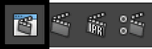

# 渲染视图(Render View)

在主菜单栏中：“窗口 > 渲染编辑器 > 渲染视图”(Window > Rendering Editors > Render View)

在场景视图中：“面板”(Panels)>“面板 > 渲染视图”(Render View)

 <!-- baize:img-hook downloaded=true reason="正文 99 字 <300 且带图" -->
