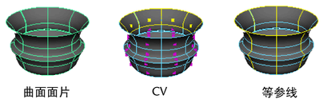

# NURBS 曲面、多边形和细分的细分

无需调整多边形网格或细分曲面的细分，除非这些曲面是已映射的置换。

NURBS 曲面由一个或多个面片组成。（有关 NURBS 曲面的详细信息，请参见 [NURBS 曲线和曲面的次数](https://beehive.autodesk.com/community/service/rest/cloudhelp/resource/cloudhelpchannel/guidcrossbook/jsonp?v=2022&p=MAYAUL&l=CHS&accessmode=live&guid=GUID-0C6DD36E-E336-4DE2-ADA1-86665998EF77)。）在渲染过程中，每个面片将分成适当的三角形数，以接近曲面的真实形状。

 <!-- baize:img-hook downloaded=true reason="正文 227 字 <300 且带图" -->

可以在所有对象或选定对象中设置 NURBS 细分（请参见[渲染 > 设置 NURBS 细分(Render > Set NURBS Tessellation)](../../../../渲染参考/渲染参考/“渲染”%28Rendering%29菜单集/“渲染”%28Render%29菜单/设置%20NURBS%20细分选项%28Set%20NURBS%20Tessellation%20Options%29.md)），也可以通过选择对象并在对象的属性编辑器中调整设置，在单个基础中设定 NURBS 细分。
