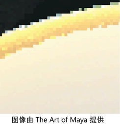

# 抗锯齿和闪烁

 <!-- baize:img-hook downloaded=true reason="正文 242 字 <300 且带图" -->

动画中基于像素的图像或闪烁曲面中的凹凸边或阶梯边即为锯齿瑕疵。

锯齿瑕疵产生于点采样过程，所有计算机图形应用程序中都使用该过程来确定有关每个像素的信息。锯齿瑕疵可能会在任何渲染过程的不同阶段中产生。

抗锯齿是消除或降低这些瑕疵的过程。由于存在多种锯齿效果（例如颗粒曲面、闪烁和凹凸边），因此控制或修复这些问题有很多方法。可以调整很多设置来减少或消除锯齿瑕疵和闪烁。请参见[调整抗锯齿](../../../可视化和渲染图像/可视化和渲染图像/为渲染调整场景设置/调整抗锯齿.md)。

大多数控制锯齿的解决方案都非常耗时，并会延长渲染时间。尽量找到在图像质量与性能之间达到最佳平衡的解决方案。
