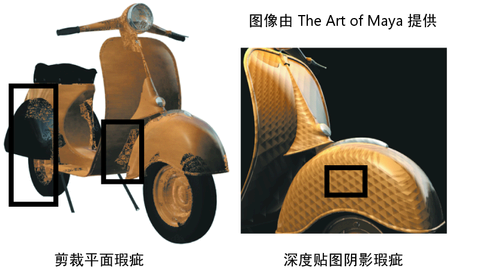

# 瑕疵

 <!-- baize:img-hook downloaded=true reason="正文 173 字 <300 且带图" -->

瑕疵可以显示为曲面上无意的污点、标注栏或交叉排线。在动画播放过程中，纹理可以从帧到帧在曲面上闪烁或爬行。

## 剪裁平面瑕疵

特别是在对象离得很近的大型场景中，背景曲面可能看起来会透出附近的曲面。这是摄影机的剪裁平面如何确定几何体的深度位置的结果；问题是由用于存储深度信息的受限制精度产生的。它主要受下列摄影机参数影响：近剪裁距离、远剪裁距离和摄影机角度。
