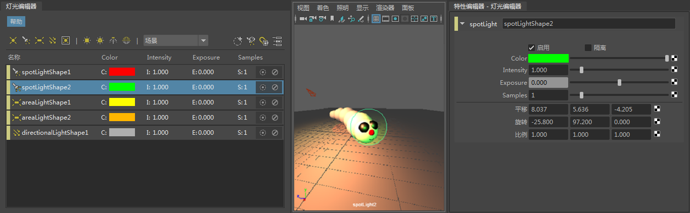

# 使用沿选定对象观看(Look Through Selected)定位灯光

使用灯光编辑器中的“沿选定对象观看”(Look Through Selected)功能，可以轻松调整相对于场景中对象的灯光位置。

选择灯光并单击  <!-- baize:img-hook downloaded=true reason="正文 250 字 <300 且带图" -->，将出现一个小窗口，其中显示的视口允许您像使用视口面板菜单中的“面板 > 沿选定对象观看”(Panels > Look Through Selected)一样定位灯光。按住 Shift 键并选择对象，然后单击 F 键，对象将框显在此窗口中，使您可以轻松调整相对于对象的灯光位置。

此窗口可以停靠到 Maya UI 中，或者停靠到灯光编辑器工作区中，使其位于灯光属性的上方或下方、左侧或右侧。

 <!-- baize:img-hook downloaded=true reason="正文 250 字 <300 且带图" -->
