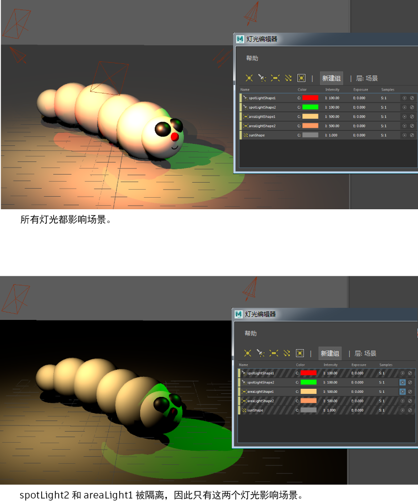

# 隔离灯光子集的效果

使用灯光编辑器隔离灯光子集，以便只有这些灯光在场景中生效。

切换隔离图标。 <!-- baize:img-hook downloaded=true reason="正文 185 字 <300 且带图" --> 表示“隔离选择”(Isolate Select)处于启用状态，而  <!-- baize:img-hook downloaded=true reason="正文 185 字 <300 且带图" --> 表示“隔离选择”(Isolate Select)处于禁用状态。

隔离灯光时，仅该灯光会影响场景。所有其他灯光均不会影响场景，并在“灯光编辑器”(Light Editor)中显示有对角线图案。您可以隔离多个灯光。为方便起见，您还可以隔离灯光组。

 <!-- baize:img-hook downloaded=true reason="正文 185 字 <300 且带图" -->
