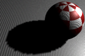

# 受照明表面上的黑斑或条纹（阴影外部）疑难解答

 <!-- baize:img-hook downloaded=true reason="正文 110 字 <300 且带图" -->

执行下列操作之一：

- 启用“使用中间距离”(Use Mid Dist)以使阴影投射灯光照亮表面。

- 稍微增加“深度贴图阴影属性”(Depth Map Shadow Attributes)中的“偏移”(Bias)，以使阴影投射灯光照亮表面。
