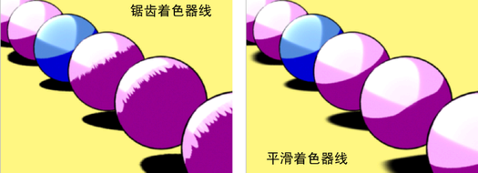

# 锯齿边疑难解答

（使用区域灯和阴影深度贴图）

如果对象具有指定的渐变着色器（调整为类似于卡通着色器）并通过带有深度贴图阴影的区域光照亮，那么着色器的线可能会产生锯齿边。若要解决此问题，增加“过滤器大小”(Filter Size)（位于区域光的“属性编辑器”(Attribute Editor)中的“深度贴图阴影属性”(Depth Map Shadows Attributes)）。如果还不足以消除锯齿边，同时增加“偏移”(Bias)属性。

 <!-- baize:img-hook downloaded=true reason="正文 205 字 <300 且带图" -->
