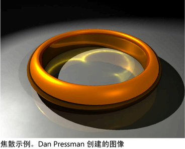

# 实际的灯光和阴影

实际上，当灯光照射在曲面上时，曲面面向光源的部分将被照亮，曲面背向光源的部分将变暗。如果某个对象位于第二个对象和光源之间，那么第一个对象会将阴影投射到第二个对象上。

 <!-- baize:img-hook downloaded=true reason="正文 118 字 <300 且带图" -->

## 相关主题

- [直接光源](直接光源.md)

- [间接（全局）与直接照明](间接（全局）与直接照明.md)

- [使用标准曲面着色器对玻璃或金属建模](https://help.autodesk.com/cloudhelp/2022/CHS/Maya-LightingShading/files/GUID-426580A4-6079-46A2-B651-E3CE38A5DEB8.htm)
