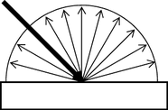
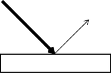
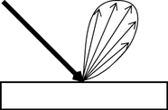

# 反射类型

反射分为三种类型：漫反射、镜面反射和光泽反射。

## 漫反射

|  <!-- baize:img-hook downloaded=true reason="正文 230 字 <300 且带图" --> | 漫反射表面以许多角度反射（散射）光。 漫反射比其他任何类型的光线分布都呈现更多的颜色，因为大多数物体都是不透明的，并且以漫反射方式反射光。 |
|---|---|

## 高光反射

|  <!-- baize:img-hook downloaded=true reason="正文 230 字 <300 且带图" --> | 高光表面反射光的角度与光照射到表面的角度相同。 高光反射使物体呈现出光泽或像镜面一样的外观。 |
|---|---|

## 光泽反射

|  <!-- baize:img-hook downloaded=true reason="正文 230 字 <300 且带图" --> | 光泽表面实际上是高光表面，具有与表平面呈各种角度的微表面。 这些微表面不仅以高光方式反射光，还以漫反射方式反射光（角度非常接近于高光透射），从而使表面呈现出光泽的外观。 |
|---|---|
